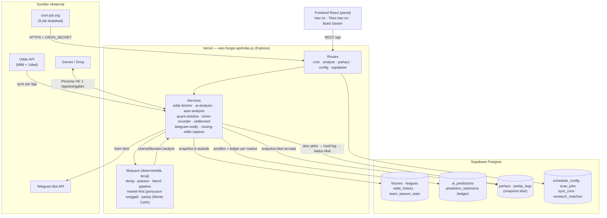
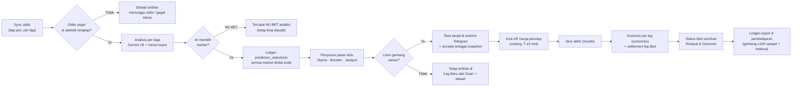
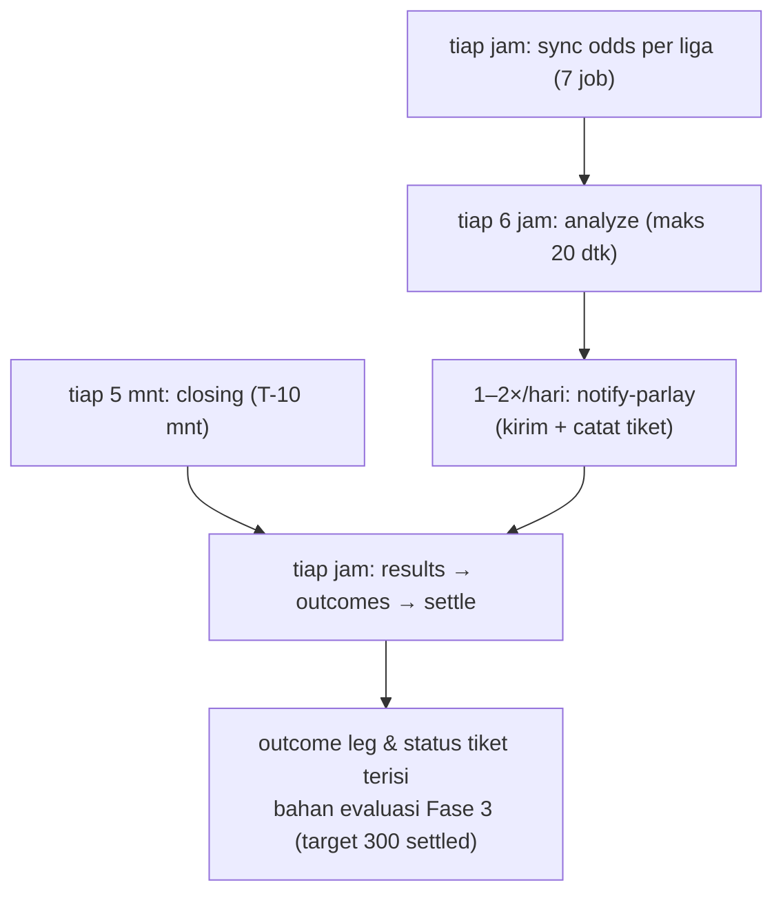

# Blueprint Arsitektur — Parlay Analyzer System

Dokumen ini adalah **sumber kebenaran desain** sistem: teknologi yang
dipakai dan alasannya, bagaimana komponen saling terhubung, rancangan
basis data, standar kualitas, dan peta jalan pengembangan. Ditulis dan
dipelihara oleh peran Software Architect / Tech Lead.

Dokumen pendamping: [system-map.md](system-map.md) (peta satu halaman
untuk pemakaian harian), [consultant-charter.md](consultant-charter.md)
(piagam kejujuran produk), `CRON_JOBS.md` (sumber kebenaran jadwal),
[quant-playbook.md](quant-playbook.md) (aturan kuantitatif).

---

## 1. Tujuan bisnis (diterjemahkan dari kebutuhan pemilik sistem)

Sistem ini adalah **mesin rekomendasi parlay yang bisa diaudit**, bukan
mesin janji menang:

1. Pemilik sistem memasang taruhan di aplikasi **Saba** dengan modal
   kecil mengincar pengembalian besar. Ia tidak mau menebak jenis
   market; sistem yang menentukan market per pertandingan dari odds +
   statistik.
2. Setiap rekomendasi wajib: nama tim, label market yang bisa dibaca
   manusia, leg 5–8, odds leg ≥ 1,25, probabilitas dan EV **jujur**
   (termasuk bila EV negatif), dan bisa ditemukan di Saba
   (bookmaker eksekusi **M88** sebagai proksi Saba).
3. Setiap tiket yang direkomendasikan **tercatat** dan akhirnya bisa
   dijawab menang atau kalah. Klaim kualitas hanya boleh datang dari
   catatan live (ledger + outcome), bukan dari rasa atau backtest saja.
4. Sistem berjalan sendiri lewat penjadwalan eksternal; pemilik sistem
   hanya membaca Telegram/panel dan memasang taruhan.

Konsekuensi desainnya: **determinisme di atas kreativitas**. Angka
dihitung kode yang bisa diuji; AI bahasa hanya membaca konteks tak
terstruktur. Setiap keputusan penting bisa direproduksi dari data.

## 2. Prinsip arsitektur (tidak bisa ditawar)

| # | Prinsip | Wujud konkret di kode |
|---|---------|----------------------|
| P1 | Pasar adalah hakim probabilitas | De-vig odds → `p_market_fair`; model statistik (λ Poisson) maksimal bobot 0,30 dalam blend (`lib/quant/blend.ts`, `devig.ts`) |
| P2 | LLM tidak menghitung | Persona V6 (`lib/quant/llm-contract.ts`): Gemini menilai satu laga, mengusulkan pengali λ 0,88–1,12 berbukti; EV/stake/probabilitas final selalu dihitung kode |
| P3 | Satu penyusun tiket | `buildParlayVariants` (`lib/quant/market-first.ts`) untuk dashboard & Telegram. Penyusun lama (komposer EV, batch parlay) sudah dipensiunkan/dimatikan |
| P4 | Satu bandar eksekusi | M88 (proksi Saba) diutamakan per keluarga market; keluarga yang hilang di M88 dipinjam utuh dari 1xbet dan **wajib** berlabel `acuan` (`lib/quant/adapter.ts`) |
| P5 | Tidak ada angka tanpa asal | Setiap leg membawa bookmaker, `p_market`, `p_model`, EV konservatif, label karakter statistik; tiket menampilkan probabilitas gabungan & EV jujur |
| P6 | Gagal itu terlihat | Analisis yang ditolak menyebut alasan (odds basi, statistik kosong); scan melaporkan `failures[]`; NO BET analitis ≠ gagal teknis |
| P7 | Rekomendasi = catatan | Tiket yang terkirim/tercatat adalah snapshot tak bisa diubah (`ticket-recorder.ts`); perubahan susunan = catatan baru |
| P8 | Penjadwalan eksternal eksplisit | cron-job.org adalah pemicu produksi (`CRON_JOBS.md`); Vercel Cron hanya jaring pengaman harian; scheduler internal opt-in (`SCHEDULER_ENABLED`) |

## 3. Teknologi yang dipakai (dan keputusan atasnya)

| Lapisan | Teknologi | Keputusan |
|---|---|---|
| Monorepo | pnpm workspace (Node ≥20, TypeScript 5.9) | **Pertahankan.** Satu bahasa ujung-ke-ujung; tipe dibagi via `lib/api-zod`, `lib/db`, `lib/supabase-client` |
| Frontend | React + Vite + Tailwind CSS + TanStack Query + wouter | **Pertahankan.** SPA ringan; tidak perlu SSR — panel bersifat operasional internal |
| API | Express 5 dibundel esbuild → satu fungsi Vercel (`api/index.js`, maxDuration 60 dtk) | **Pertahankan dengan batas sadar:** semua pekerjaan cron wajib anggaran waktu; tidak ada job > 50 detik |
| Database | Supabase (Postgres) + PostgREST via supabase-js | **Pertahankan.** Migrasi SQL di `supabase/migrations/` adalah satu-satunya jalur perubahan skema |
| AI | Gemini (`@google/generative-ai`), fallback Groq | **Pertahankan, terikat kontrak V6.** Provider boleh berganti; kontrak JSON & peran tidak |
| Data odds | Odds-API (M88 + 1xbet) → `odds_history` | **Pertahankan.** M88 = eksekusi; 1xbet = acuan per keluarga |
| Notifikasi | Telegram Bot API | **Pertahankan.** Kanal baca utama pemilik sistem |
| Penjadwalan | cron-job.org (8 job) | **Pertahankan** sebagai pemicu produksi; GitHub Actions hanya untuk ingest riset |
| Riset | GitHub Actions → tabel `research_matches` (16rb+ laga) | **Pertahankan terpisah** dari jalur live; tulis via PostgREST fetch (bukan supabase-js di Node 20) |
| Logging | pino | **Pertahankan.** Kegagalan shadow/ledger tidak pernah mematahkan jalur utama, tapi selalu tercatat |

Yang **sengaja tidak dipakai**: antrean pesan/Redis (volume belum
membutuhkannya; anggaran waktu + idempotensi cukup), microservices
(satu fungsi serverless lebih murah diaudit), dan framework AI agent
(kontraknya satu panggilan terstruktur per laga — agent bebas adalah
risiko, bukan kebutuhan).

## 4. Diagram komponen



Aturan arah dependensi: `routes → services → lib/quant`. `lib/quant`
murni (tanpa I/O) sehingga bisa di-backtest dan diuji unit; services
boleh menyentuh DB/jaringan; routes hanya orkestrasi tipis.

## 5. Flowchart alur kerja utama

### 5.1 Siklus hidup satu rekomendasi



### 5.2 Ritme penjadwalan (cron-job.org)



Setiap job **idempoten** dan **beranggaran waktu**: gagal sebagian
tidak merusak putaran berikutnya, dan status terakhir selalu bisa
dibaca dari DB (bukan dari ingatan proses).

## 6. Rancangan basis data

Kelompok tabel dan relasi intinya (skema otoritatif: file migrasi):

```mermaid
erDiagram
    leagues ||--o{ fixtures : "menyelenggarakan"
    fixtures ||--o{ odds_history : "snapshot harga"
    fixtures ||--o| ai_predictions : "dinilai AI (unik per fixture)"
    fixtures ||--o{ prediction_selections : "ledger per market"
    fixtures ||--o{ parlay_legs : "leg tiket"
    parlays ||--o{ parlay_legs : "snapshot tiket"

    fixtures {
        int fixture_id PK
        text home_team_name
        text away_team_name
        text league_name
        timestamptz fixture_date
        int home_goals
        int away_goals
        text status_short
    }
    odds_history {
        bigint id PK
        text match_id FK
        text bookmaker
        text market_type
        numeric odds_1
        numeric odds_2
        numeric odds_draw
        timestamptz captured_at
    }
    ai_predictions {
        uuid id PK
        text fixture_id FK_UK
        text best_market
        numeric best_odds
        numeric confidence_score
        text status
        text prediction_text
        jsonb evaluation_snapshot
    }
    prediction_selections {
        bigint id PK
        text fixture_id FK
        text market_key "ML:home / TOT:over:2.5 / BTTS:yes / AH:away:1"
        numeric odds
        numeric p_final
        numeric p_market_fair
        numeric p_model_only
        numeric ev_conservative
        numeric odds_close
        text outcome "win/loss/push/… atau null"
        text bookmaker "M88 / 1xbet"
        int model_version "1=LLM, 2=kuant"
    }
    parlays {
        uuid id PK
        text parlay_name
        int legs_count
        numeric combined_odds
        numeric win_probability
        text status "active/won/lost/settled"
        text generated_by "MARKET_FIRST_*, USER_*, AI_BATCH(warisan)"
    }
    parlay_legs {
        bigint id PK
        uuid parlay_id FK
        bigint prediction_id "null untuk tiket pasar-dulu"
        int fixture_id FK
        text market "label manusia, mis. Over 2.5 Goals"
        numeric odds
        numeric probability
        text result "WIN/LOSS/… atau null"
    }
```

Aturan integritas yang dijaga kode (bukan hanya skema):

- **Satu prediksi per fixture** — upsert `onConflict: fixture_id`;
  prediksi tanpa market = keputusan NO BET yang selesai (tidak
  dianalisis ulang tanpa henti).
- **Ledger append-only per analisis** — upsert
  `(fixture_id, model_version, market_key)`; `odds_close` dan
  `outcome` hanya diisi job closing/outcomes, tidak pernah oleh
  analisis.
- **Snapshot tiket tidak bisa diubah** — perubahan susunan membuat
  baris `parlays` baru; anti-duplikat memakai tanda tangan isi tiket
  (varian + himpunan `fixtureId:marketKey`) per hari.
- **Kunci market tunggal** — format `ML:home`, `TOT:over:2.5`,
  `BTTS:yes`, `AH:away:1` dipakai konsisten dari pipeline sampai
  Telegram; label manusia hanya untuk tampilan
  (`friendlyMarketLabel`).

Tabel warisan `teams`/`team_aliases` adalah tabel yatim (tidak
dipakai jalur live) — keputusan penghapusan menunggu satu migrasi
pembersihan khusus, bukan dihapus diam-diam.

## 7. Kontrak antar komponen

| Kontrak | Bentuk | Penjaga |
|---|---|---|
| Prompt Gemini | Persona V6 + blok data per laga + Kontrak Penutup; balasan JSON `{selections[], lambda_adjustment}` | `llm-contract.ts`, parser toleran `extractPredictionRecommendation` + test regresi |
| Ledger → penyusun | Baris `prediction_selections` → kandidat (`candidatesFromSelectionRows`), dedupe utamakan M88 | `parlay-candidates.ts` |
| Penyusun → tampilan/Telegram | `ParlayVariants` (utama/booster/jackpot + `variantNotes`) | `market-first.ts`, `telegram-format.ts` |
| Tiket tercatat | `generated_by = MARKET_FIRST_<VARIAN>`; leg label manusia, `prediction_id = null` | `ticket-recorder.ts` |
| Settlement | Skor `fixtures` → hasil leg (`calculateResult`) → status tiket | `settlement.ts`, `parlay-builder.ts` |
| Cron | `GET /api/cron?token=…&action=…`, semua aksi menjawab ringkasan JSON | `routes/cron.ts`, `CRON_JOBS.md` |
| Panel | REST `/api/...` dengan tipe dari `parlay-hooks.ts`; aksi admin wajib `x-admin-password` | `middlewares/admin.ts` |

## 8. Standar kualitas & alur pengembangan

**Definition of Done** untuk setiap perubahan (dipakai di semua PR
sampai saat ini dan wajib dipertahankan):

1. Branch khusus dari `main` terbaru; satu PR = satu keputusan.
2. Test unit untuk logika murni (`lib/quant`, parser, recorder) —
   suite saat ini 415 test; regresi produksi wajib jadi test.
3. `tsc` bersih untuk API **dan** frontend; `build:vercel` dan build
   frontend lolos.
4. PR berisi: masalah, bukti (data produksi bila relevan), akar
   masalah, perbaikan, verifikasi, dan aksi lanjutan pemilik sistem.
5. Merge → deploy Vercel diverifikasi (`READY`/`PROMOTED` + alias
   produksi) sebelum dinyatakan selesai.
6. Perubahan perilaku terjadwal selalu memperbarui `CRON_JOBS.md`;
   perubahan skema selalu lewat file migrasi baru.

**Review arsitektur** wajib bila menyentuh: kontrak LLM, format
`market_key`, gerbang varian, aturan bookmaker, atau skema ledger —
lima titik di mana kesalahan kecil meracuni data historis.

## 9. Utang teknis & risiko terdaftar

| # | Risiko/utang | Dampak | Mitigasi terjadwal |
|---|---|---|---|
| R1 | Statistik Bundesliga belum lengkap (Bayern/Cologne) | Laga ditolak teknis | Lengkapi ingest 18/18 tim; panel kesehatan statistik sudah menandai |
| R2 | `odds_close` belum terisi (jendela closing sempit) | CLV belum bisa dihitung penuh | Audit job closing vs jadwal kick-off; perluas jendela tangkap |
| R3 | Satu fungsi Vercel 60 detik | Job besar harus dipecah | Anggaran waktu per aksi + antrean berbasis prioritas kick-off (sudah pola baku) |
| R4 | Tabel yatim `teams`/`team_aliases` | Kebingungan skema | Satu migrasi pembersihan khusus setelah dipastikan tak ada pembaca |
| R5 | Scheduler internal masih ada (opt-in) | Dua jalur pemicu bisa aktif ganda | Biarkan nonaktif; dokumentasikan cron-job.org sebagai satu-satunya pemicu |
| R6 | Sampel live settled belum mencapai gerbang Fase 3 (300) | Klaim kualitas belum boleh dinaikkan | Ritme analyze/settle berjalan; ledger-report memantau jumlah |

## 10. Peta jalan

**Fase A — Data utuh (sekarang).** Bundesliga 18/18; closing odds
mengalir; tidak ada laga "gagal teknis" karena data yang sebenarnya
bisa dilengkapi. *Selesai bila:* satu pekan tanpa kegagalan analisis
karena statistik kosong.

Kemajuan 23 Nov 2026: Bundesliga 2026-27 **18/18** — Bayern Munich dan
1. FC Cologne diisi dari derivaasi deterministik skor akhir milik
sistem sendiri (`src/lib/derived-team-stats.ts`,
`scripts/derive-missing-team-stats.ts`; `stats_xg` berupa proxy yang
disusutkan ke rata-rata liga, selalu kalah dari baris FootyStats asli
lewat jalur merge ingest). *odds_close* 0/1044 terdiagnosis: harga
hanya diisi dalam jendela T-10 menit dan kandidat dibatasi fixture
masa depan, jadi satu putaran terlewat = hilang selamanya. Kini ada
jalur backfill ≤48 jam dari snapshot pra-kick-off
(`CLOSING_BACKFILL_HOURS` di `closing-odds-capture.ts`) — job closing
cukup berjalan per-jam, tidak lagi wajib 5 menit.

**Fase B — Bukti live.** Snapshot Tiket Hari Ini ter-settle rutin;
laporan pertama tiket live (Utama/Booster/Jackpot: menang dari total,
ROI pada odds tercatat) dari `parlays`, berdampingan dengan ledger
per-leg menuju gerbang 300 settled. *Selesai bila:* laporan tiket
live pertama terbit dari data, bukan simulasi.

Kemajuan 23 Nov 2026: snapshot live pertama tercatat (Utama 6 leg,
Booster 5 leg, Jackpot 5 leg) dan laporan tiket live terbit sebagai
`GET /parlays/live-report` + panel "Laporan Tiket Live"
(`lib/live-ticket-report.ts`): per varian tercatat/aktif/menang/
kalah, hit-rate vs probabilitas yang dijanjikan (selisih kalibrasi),
ROI taruhan satuan, label sampel kecil di bawah 10 tiket settled,
dan bilah kemajuan ledger menuju 300. Audit di hari yang sama
menemukan snapshot pertama itu **tercemar look-ahead**: komposer
membaca ledger tanpa pagar waktu, sehingga tiket berisi laga
20–22 Nov yang sudah selesai saat dicatat 23 Nov. Perbaikan
struktural: pagar `isFixtureComposable` di
`candidatesFromSelectionRows` (satu-satunya chokepoint komposisi —
fixture yang sudah kick-off/selesai dibuang; kedua loader kini
mengisi metadata kick-off), dan laporan live mengeluarkan tiket
yang dicatat setelah kick-off leg-nya (`lateRecordedTickets`,
ditampilkan terbuka, tidak dihapus dari basis data). Bukti live
hanya sah dari tiket yang dicatat sebelum pertandingan dimulai —
konsekuensi langsung P7.

**Fase C — Kalibrasi.** Dengan bukti Fase B: sesuaikan bobot blend
(≤0,30), ambang gerbang varian, dan kebijakan pembelajaran — selalu
lewat gerbang statistik (≥100 sampel latih + holdout), selalu lewat
PR dengan backtest pendamping.

Setiap fase tidak mengubah prinsip P1–P8. Bila suatu kebutuhan baru
bertabrakan dengan prinsip, prinsipnya yang didiskusikan ulang secara
eksplisit di dokumen ini — bukan dilanggar diam-diam di kode.
